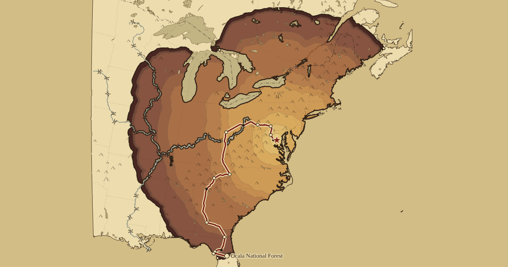

<!-- Drafted by Claude from the page's own text. Edit freely: this is meant to be in your words. -->

# Mount Doom Is Closer Than You Think

**[View the map →](https://ajdur96.github.io/Distance-to-Mt-Doom/)**

What if Bag End stood in Arlington, Virginia? This interactive map takes the distances of Frodo's journey in *The Lord of the Rings* and lays them across North America. Instead of drawing circles of miles, it measures **walking effort**: steep slopes, forests, wetlands, thin air and great rivers all slow a walker down, so each ring bends around the real landscape.



## What's on the page

- **Frodo's Journey.** A scrolling story with eleven milestones, from Bucklebury to Mount Doom. A road follows real landmarks wherever Frodo reached a milestone, with each leg matched to the miles he actually walked. Switch between two roads: one from Arlington, and one from the Hobbit Trail on the Oregon coast to the Hollywood Sign.
- **Your Journey.** Put Bag End anywhere: search for a town, click the map, or use your location. The walking model runs in your browser, draws your rings, and picks a landmark road of your own, with photos from Wikipedia.
- **How It Was Made.** The method, the land cover penalties, the sources, and the photo credits.

Any view can be shared: the address updates as you scroll (for example `#journey/2/7` opens the Hobbit Trail road at Amon Hen).

## How it works

- **Distances:** Frodo's leg lengths follow Karen Wynn Fonstad's *The Atlas of Middle-earth*, as summarized by Lord of the Steps.
- **Walking speed:** Tobler's hiking function on 250 m terrain, slowed by land cover (from 1.0× in towns to 2.5× in wetlands) and by altitude above about 4,900 ft.
- **Barriers:** the Mississippi, Missouri, Ohio and upper St. Lawrence can only be crossed at 40 bridge cities.
- **Rings:** a cost-distance calculation on a 5 km grid, corrected for the octagon bias of eight-direction movement.
- **Landmarks:** chosen from Wikidata, ranked by how many language editions of Wikipedia write about them.

The full write-up is on the page's *How It Was Made* tab.

## Sources

- Distances: Karen Wynn Fonstad, *The Atlas of Middle-earth*, via Lord of the Steps
- Elevation: AWS Terrain Tiles
- Land cover: Commission for Environmental Cooperation, North American Land Change Monitoring System (2010)
- Coastlines, lakes, rivers and borders: Natural Earth
- Landmarks: Wikidata; descriptions from English Wikipedia (CC BY-SA 4.0)
- Town names for search: GeoNames (CC BY 4.0)
- Photos: Wikimedia Commons, each credited on the page with its author and license

Built in R (terra, sf, slippymath, rnaturalearth) and drawn with D3, with help from Claude, an AI assistant made by Anthropic.

## Project layout

```
index.html        the page
css/style.css     the old-atlas styling
js/copy.js        every word on the page, in one place to edit
js/app.js         maps, charts, the walking model and routing
data/             map layers, roads, landmarks, places and the walking-pace grid
photos/           sepia landmark photos for Frodo's Journey (credits in data/photos.json)
```

## Running it locally

The page loads its data files with `fetch`, so it needs a small web server rather than a double-click:

```
python -m http.server
```

Then open <http://localhost:8000>.

## License

<!-- To decide: a license for your own code and text. Photos, Wikipedia text and map data keep their own licenses, listed above. -->
